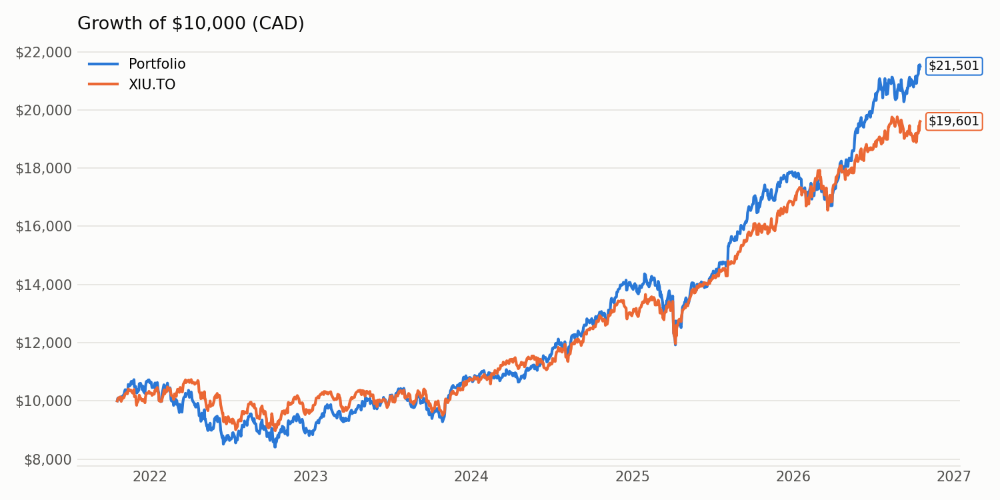
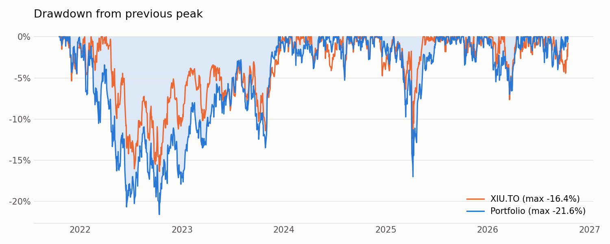
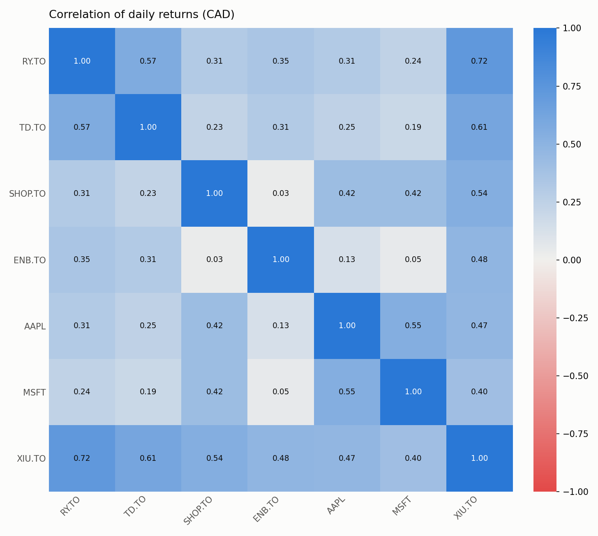
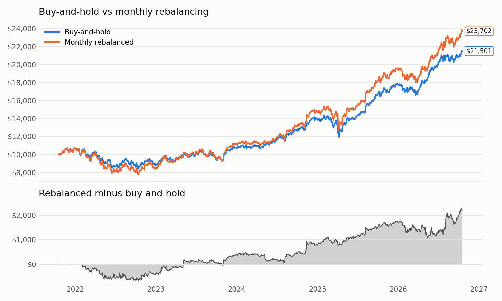
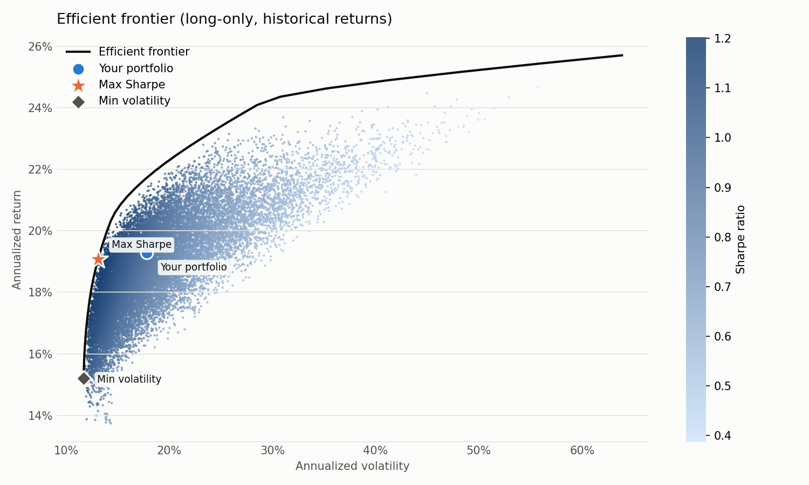
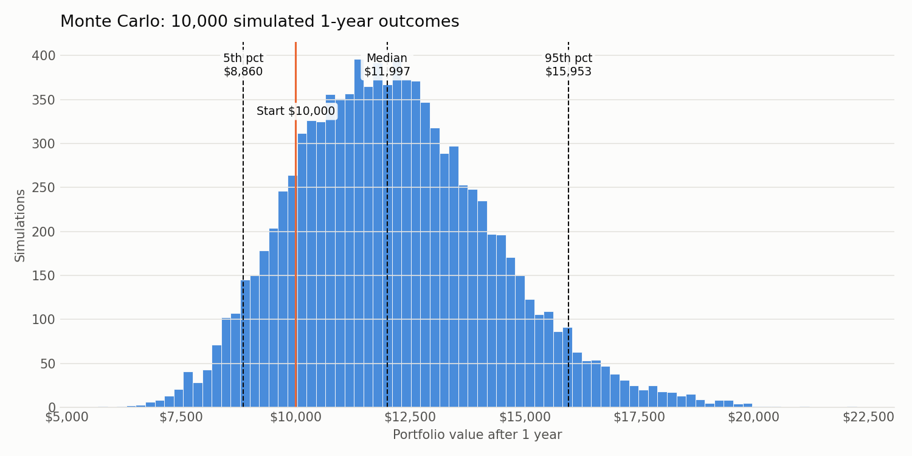

# Portfolio Performance Analyzer

A Python tool that measures how a stock portfolio performed against the market: returns, risk,
risk-adjusted return, and diversification. Stretch analyses cover rebalancing, mean-variance
optimization, and Monte Carlo simulation. It ships as a Jupyter notebook (exploration), a
command-line script (reproducible results and charts), and a Streamlit dashboard (interactive).

The sample portfolio mixes Canadian and US stocks and is analyzed **in Canadian dollars** against
the **S&P/TSX 60** (XIU.TO) over 5 years of daily data (Oct 18, 2021 to Oct 16, 2026; 1,282 trading days).

| Ticker | RY.TO | TD.TO | SHOP.TO | ENB.TO | AAPL | MSFT | XIU.TO |
|---|---|---|---|---|---|---|---|
| Weight | 20% | 15% | 15% | 15% | 15% | 10% | 10% |

## Results

### Core metrics (buy-and-hold, CAD)

| Metric | Portfolio | S&P/TSX 60 (XIU.TO) |
|---|---|---|
| Total return | 115.01% | 96.01% |
| Annualized return (CAGR) | 16.57% | 14.43% |
| Annualized volatility | 15.06% | 12.82% |
| Sharpe ratio | 0.87 | 0.86 |
| Max drawdown | −21.58% (Nov 2021 → Oct 2022) | −16.36% |
| Beta vs XIU.TO | 1.00 | 1.00 |
| $10,000 became | $21,501 | $19,601 |





### Stretch analyses

| Analysis | Result |
|---|---|
| Monthly rebalancing | 137.02% total return vs 115.01% buy-and-hold, but volatility 17.65% vs 15.06% and max drawdown −27.44% vs −21.58%; Sharpe 0.88 vs 0.87 |
| Max-Sharpe portfolio (long-only, in-sample) | Sharpe 1.22 vs 0.91 for current weights (same inputs), at 13.1% vs 17.8% volatility. Weights: RY 48.6%, TD 21.6%, AAPL 13.5%, ENB 12.5%, MSFT 3.7% |
| Monte Carlo (10,000 bootstrapped 1-year paths, $10,000 start) | Median $11,997; 5th–95th percentile $8,860–$15,953; 15.8% chance of a loss; 95% 1-year VaR $1,140 |





## Key findings

1. **The portfolio beat the TSX 60 by about 2.1 points a year, but mostly by taking more risk.** Its Sharpe ratio
   (0.87) is almost the same as the index's (0.86). Volatility was higher (15.1% vs 12.8%), and so was the
   worst drawdown (−21.6% vs −16.4%).
2. **Currency was a hidden tailwind.** USD/CAD rose 14.7% over the period, so AAPL and MSFT earned more in CAD than in USD.
   A Canadian investor's US holdings carry currency risk, and it happened to help.
3. **The holdings are moderately diversified.** Most pairwise correlations are 0.2–0.4. The two banks are the most
   correlated pair (0.57), and Enbridge barely moves with Shopify (0.03) or Microsoft (0.05).
4. **Monthly rebalancing added 22 percentage points of total return, mainly because of Shopify.** SHOP fell from C$181 to C$35
   (Oct 2022) and then recovered to C$240. Rebalancing kept buying it near the bottom, which also produced the deeper 2022 drawdown.
   That's a path-dependent result, not a general rule.
5. **The optimizer would have concentrated heavily in Canadian banks.** That reflects five years of hindsight. It is not a recommendation.

## Methodology

- **Prices.** Daily dividend- and split-adjusted closes from Yahoo Finance (`yfinance`, `auto_adjust=True`),
  so price changes represent total return.
- **Currency.** USD-listed stocks are converted to CAD daily using Yahoo's `CAD=X` rate, unhedged. That's what a
  Canadian investor experiences, and it matches the CAD benchmark. Tickers ending in `.TO`/`.V` are treated as CAD;
  everything else as USD.
- **Calendars.** Days when no holding traded are dropped. When only one exchange was closed, its prices are carried forward.
- **Risk-free rate.** The daily 3-month Government of Canada T-bill yield from the Bank of Canada Valet API
  (`TB.CDN.90D.MID`), averaging 3.14% over the period (0.11% at the start, about 5% in 2023). Sharpe uses each day's actual rate.
- **Portfolio.** $10,000 is invested at the target weights on day one and held (buy-and-hold).
- **Metrics.** CAGR = (1 + total return)^(1/years) − 1. Volatility = std(daily returns) × √252.
  Sharpe = mean(daily excess return) / std(daily excess return) × √252. Max drawdown = the lowest value of
  value / running peak − 1. Beta = cov(portfolio, benchmark) / var(benchmark).
- **Efficient frontier.** Uses annualized arithmetic mean returns and covariance of daily returns, with long-only,
  fully invested weights. There are 20,000 random portfolios plus SciPy SLSQP optimization. Because it assumes fixed weights and
  arithmetic means, its "current portfolio" figures differ from the buy-and-hold metrics above.
- **Monte Carlo.** Bootstrap resampling of whole historical trading days (keeping the cross-asset correlation and fat tails),
  10,000 paths × 252 days, with a fixed random seed.
- **Reproducibility.** The downloaded data is saved in `data/`, so every number here can be reproduced exactly.

## Limitations

- Backtests ignore trading costs, taxes, and withholding tax on US dividends.
- Five years is a short sample, and it includes one bear market (2022) and a strong recovery.
  Historical results, the optimizer and the Monte Carlo all assume the future resembles this window.
- XIU.TO is both a 10% holding and the benchmark, which pushes correlation and beta up slightly.

## How to run

Requires Python 3.9–3.12 (the pinned NumPy and SciPy versions have no wheels for newer Pythons).

```bash
python3 -m venv .venv
source .venv/bin/activate
pip install -r requirements.txt
```

| What | Command |
|---|---|
| Full analysis: prints metrics, saves `charts/` and `results/summary.json` | `python main.py` |
| Same, with freshly downloaded data | `python main.py --refresh` |
| Step-by-step notebook | `jupyter lab portfolio_analyzer.ipynb` |
| Interactive dashboard | `streamlit run app.py` |

To analyze a different portfolio, edit `PORTFOLIO` in `config.py` (weights must sum to 1). In the dashboard,
you can also edit tickers and weights in the sidebar.

## Project structure

```
config.py                 portfolio and settings
analyzer.py               data loading, metrics, optimization, simulation, charts
main.py                   command-line entry point
app.py                    Streamlit dashboard
portfolio_analyzer.ipynb  exploratory notebook with explanations; cross-checks analyzer.py
data/                     saved price, FX and risk-free snapshot
charts/                   generated charts
results/summary.json      generated numbers
```

## License

MIT. See [LICENSE](LICENSE).
